UNIVERSIDAD DE SAN CARLOS DE GUATEMALA

FACULTAD DE INGENIERIA

ESTRUCTURA DE DATOS

CATEDRÁTICO: ING. ESPINO

============================================================================================

  
  

    <h1 style="color: blue; text-decoration: underline; text-decoration-color: black;" >MANUAL DE USUARIO AUTOGEST PRO</h1>
  

============================================================================================

OTTONIEL FABRICIO VÁSQUEZ PINEDA
 
CARNÉ: 202307820
 
SECCIÓN C

GUATEMALA 24 DE SEPTIEMBRE DEL 2025

============================================================================================

 
 
 
<h2 align="center"> Introducción </h2>
AutoGest Pro es un sistema integral para la gestión de talleres de reparación de vehículos. Con esta herramienta podrás:

Registrar vehículos y clientes.
Gestionar repuestos, servicios y facturación.
Visualizar reportes e informes relevantes sobre el taller.
Subir archivo .JSON para registrar más rapido a los usuarios, vehículos y repuestos.
Este manual te ayudará a navegar por la aplicación, explicándote paso a paso cómo realizar cada acción.

<h2 align="center"> Requisitos del sistema </h2>
Antes de comenzar, asegúrate de contar con:

* **Sistema Operativo:** Linux (distribución libre).
* **Software Necesario:**
  - .NET para ejecutar la aplicación en C#.
  - Librería GTK para la interfaz gráfica.
  - Graphviz para la generación de reportes visuales.
  
<h2 align="center"> Instalación </h2>
Descarga y Compilación:
Descarga el código fuente desde el repositorio de GitHub asignado.
Abre el proyecto en tu IDE favorito y compílalo utilizando .NET.

 

- Configuración Inicial:
Verifica que el archivo de configuración (App.config o similar) esté correctamente ajustado según las dependencias requeridas.

- Asegúrate de tener instaladas las librerías GTK y Graphviz.

<h2 align="center"> Acceso al sistema </h2>

1. Pantalla de Inicio de Sesión
Al abrir la aplicación, se te presentará la ventana de inicio de sesión.
Campos requeridos:
    * Correo: Ingresa tu dirección de correo.
    * Contraseña: Ingresa tu contraseña.
    * Cuenta Administrador (Root):
    * Usuario: root@gmail.com
    * Contraseña: root123

  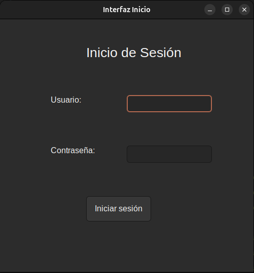

2. Funcionalidades Principales
5.1. Menú Principal
Una vez iniciada la sesión, verás el menú principal con las siguientes opciones:

    * Carga Masiva
    * Ingresos Individuales
    * Gestión de Usuarios
    * Generar Servicio y Factura
    * Cancelar Factura
    * Reportes

  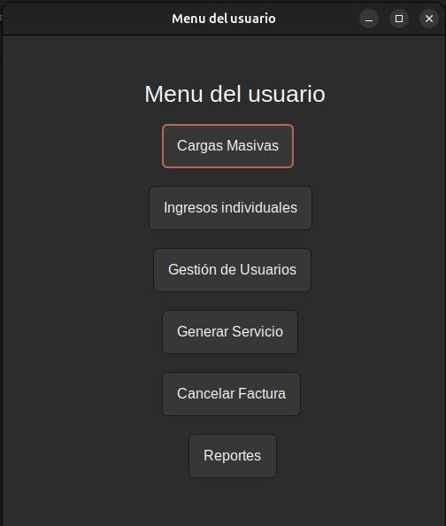

3. Carga Masiva
Esta función está destinada exclusivamente para el usuario root. Permite importar datos en formato JSON para:

Usuarios
Vehículos
Repuestos

  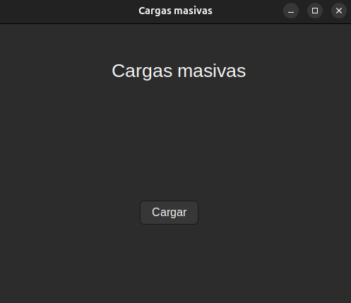

* Pasos para la carga masiva:

Selecciona la opción "Carga Masiva".
Elige la entidad que deseas cargar.
Selecciona el archivo JSON correspondiente desde tu sistema.

Ejemplo de código JSON para cargar usuarios
Inserta este fragmento en el archivo JSON que usarás para la carga de Usuario:

~~~json
[
  { 
    "ID": 1, 
    "Nombres": "Juan", 
    "Apellidos": "Pérez", 
    "Correo": "juan.perez@mail.com", 
    "Contrasenia": "123456" 
  },
  { 
    "ID": 2, 
    "Nombres": "María", 
    "Apellidos": "Gómez", 
    "Correo": "maria.gomez@mail.com", 
    "Contrasenia": "password123" 
  }
]
~~~

4. Ingreso Manual
Si prefieres ingresar la información de forma individual:

Selecciona "Ingreso Manual" en el menú.
Elige la entidad a registrar (Usuarios, Vehículos, Repuestos o Servicios).

  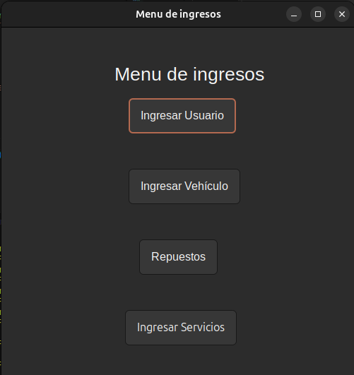

4. 1. Usuario:
En la ventana de ingreso manual de Usuario se le mostrara que tiene que ingresar algunos datos de usuario, tiene que llenar todos los datos o sino le mandará error de que tiene que llenar todos los campos requeridos 

  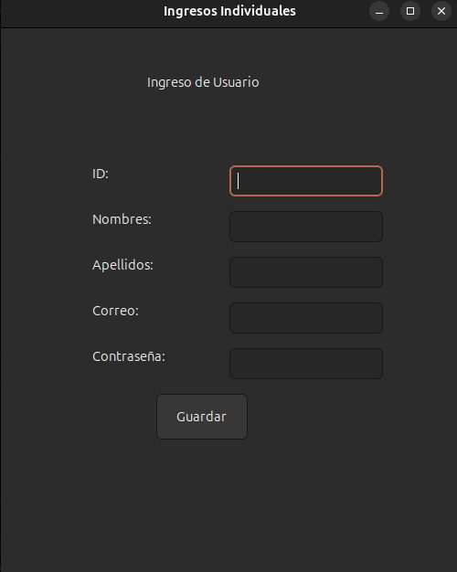

4. 2. Vehículo:
En la ventana de ingreso manual de vehículo se le mostrará que tiene que ingresar algunos datos para el vehículo, en la cual tiene que llenar todos los campos que se le pide o sino no se podrá guardar el vehículo.

  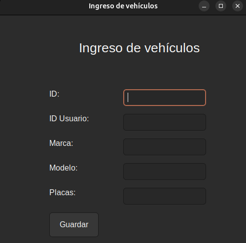

4. 3. Repuestos:
En la ventana de ingreso manual de repuestos se le mostrará en la cual tiene que ingresar ciertos datos para guardar el repuesto, en la cual si no se ingresa todos los datos no se podrá guardar el repuesto que usted quiera ingresar.

  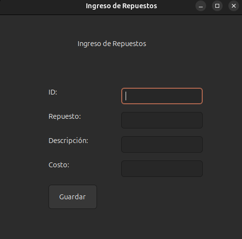

4. 4. Servicio:
En la ventana de ingreso manual de servicios, se le mostrará unos campos en la cual tiene que llenarlos todos o sino le marcará error sino se llenan todos, ya que es obligatorio llenar todos los campos.

  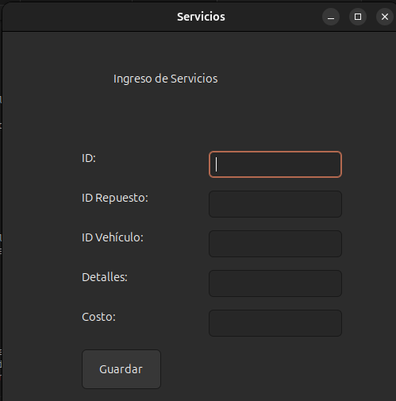

5. **Gestión de Usuarios**

Esta opción te permite:

  * Ver Usuario: Consulta la información completa del usuario, incluyendo los vehículos registrados por medio de su id.
  * Editar Usuario: Modifica datos como nombres, apellidos y correo por medio de su id.
  * Eliminar Usuario: Remueve un usuario del sistema mediante su ID.

  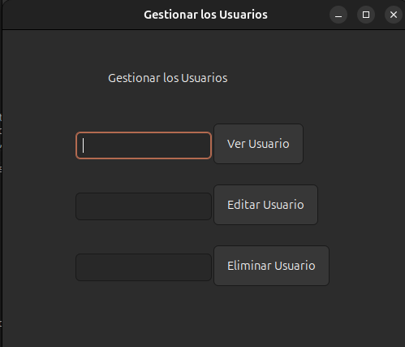

6. **Generar Servicio**

* Completa los campos solicitados:
  * ID del Servicio
  * ID del Vehículo
  * ID del Repuesto
  * Detalles del servicio
  * Costo del servicio

El sistema validará si el vehículo y el repuesto existen. En caso contrario, mostrará un mensaje de error.

Una vez validado, se generará automáticamente el servicio (almacenada en la cola) y después también se generará la factura automáticamente (esta se almacenará en una pila) y haciendo la sumatoria del costo del servicio más el costo del repuesto.

  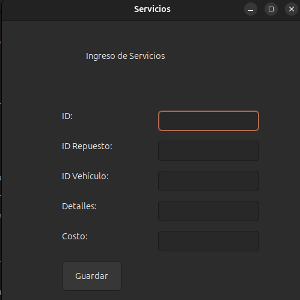

7. **Cancelar Factura**

Esta opción se utiliza para indicar que el usuario ya ha pagado el servicio:

Selecciona "Factura".
El sistema mostrará la factura generada y la retirará de la pila.

Se mostrará un resumen del pago realizado.

  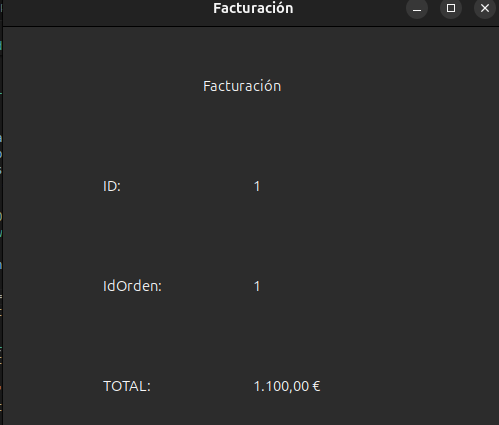

6. **Reportes**

AutoGest Pro permite generar diversos reportes que te ayudarán a visualizar la información de manera clara y gráfica. Entre los reportes disponibles se encuentran:

Reporte de Usuarios
Reporte de Vehículos
Reporte de Repuestos
Reporte de Servicios
Reporte de Facturación
Reporte de Bitácora
Top 5 vehículos con más servicios
Top 5 vehículos más antiguos
Acceso a Reportes:

Por ejemplo esto:

  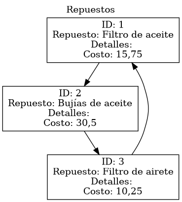

