UNIVERSIDAD DE SAN CARLOS DE GUATEMALA

FACULTAD DE INGENIERIA

ESTRUCTURA DE DATOS

CATEDRÁTICO: ING. ESPINO

============================================================================================

  
  

    <h1 style="color: blue; text-decoration: underline; text-decoration-color: black;" >MANUAL DE USUARIO AUTOGEST PRO</h1>
  

============================================================================================

OTTONIEL FABRICIO VÁSQUEZ PINEDA
 
CARNÉ: 202307820
 
SECCIÓN C

GUATEMALA 25 DE MARZO DEL 2025

# Manual de Usuario – AutoGest Pro

Bienvenido a **AutoGest Pro**, el sistema integral para la gestión de talleres de reparación de vehículos. Este manual te guiará a través de las funcionalidades disponibles, tanto para usuarios como para el administrador. A continuación se presentan las instrucciones paso a paso para que puedas aprovechar al máximo el sistema.

---

<h2 align="center"> Introducción </h2>
AutoGest Pro es un sistema integral para la gestión de talleres de reparación de vehículos. Con esta herramienta podrás:

Registrar vehículos y clientes.
Gestionar repuestos, servicios y facturación.
Visualizar reportes e informes relevantes sobre el taller.
Subir archivo .JSON para registrar más rapido a los usuarios, vehículos y repuestos.
Este manual te ayudará a navegar por la aplicación, explicándote paso a paso cómo realizar cada acción.

---

## 1. Inicio de Sesión

Al abrir **AutoGest Pro**, se presenta la pantalla de inicio de sesión.

### Pasos:
1. Ingresa tu **correo electrónico** y **contraseña** en los campos indicados.
2. Presiona el botón **"Iniciar Sesión"**.

> **Nota:**  
> El usuario administrador cuenta con las credenciales:  
> **Correo:** `admin@usac.com`  
> **Contraseña:** `admin23`

 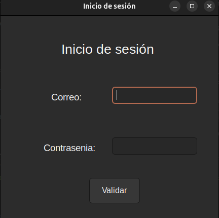

---

## 2. Menú Principal

Una vez autenticado, se mostrará el menú principal que varía según el rol del usuario (Administrador o Usuario).

### Elementos del menú Administrador:
- **Carga Masiva** (solo para Administrador)
- **Gestión de Entidades** (Usuarios, Vehículos, Repuestos)
- **Actualización de Repuestos**
- **Visualización de Repuestos**
- **Generación de Servicios y Facturas**
- **Control de Logueo**
- **Reportes**
- **Cerrar sesión**

### Elementos del menú Usuario:
- **Gestión de Vehículos**
- **Visualizacion de Servicios**
- **Visualizacion de Facturas**
- **Cancelar Facturas**
- **Cerrar sesión**

### Menu Administrador

 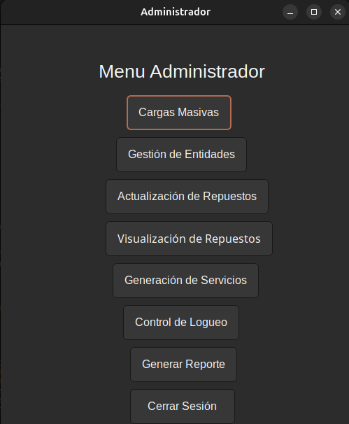

### Menu Usuario

 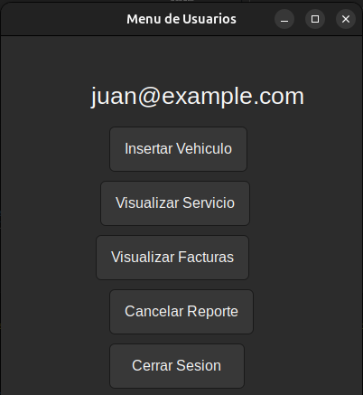

---

## 3. Funcionalidades para el Administrador

### Carga Masiva
El administrador puede cargar datos de **Usuarios**, **Vehículos** y **Repuestos** de forma masiva mediante archivos JSON.

#### Pasos:
1. Selecciona la opción **"Carga Masiva"** en el menú.
2. Elige la entidad que deseas cargar.
3. Haz clic en **"Seleccionar Archivo"** y busca el archivo JSON correspondiente.
4. Presiona **"Cargar"** para importar los datos.

 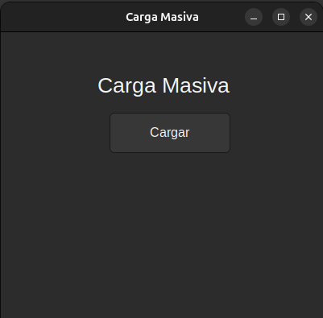

---

### Gestión de Entidades
El administrador tiene la opción de **Visualizar** y **Eliminar** registros de:
- **Usuarios**
- **Vehículos**

#### Pasos:
1. Selecciona la opción **"Gestión de Entidades"**.
2. Elige la entidad a gestionar.
3. Se mostrara si quiere ver que usuario o vehiculo quiere ver por medio del ID.
4. Para eliminar un registro, selecciona el elemento y haz clic en **"Eliminar"**.

### Gestión entidades

 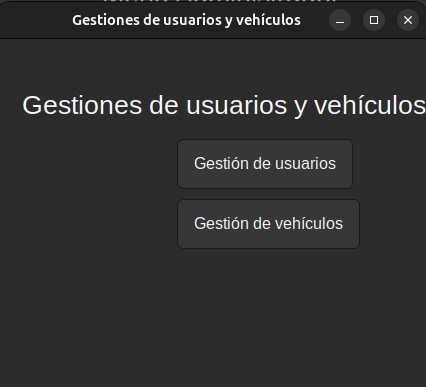

### Gestionar Usuario

 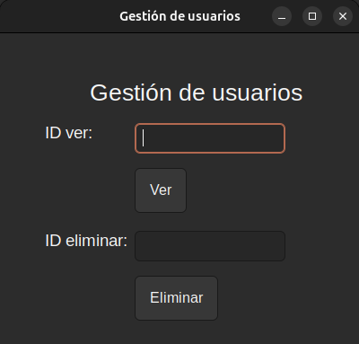

### Gestionar Vehiculos

 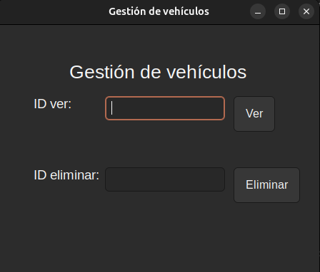

---

### Actualización de Repuestos
El administrador podrá actualizar los repuestos que se encuentran en el sistema.

 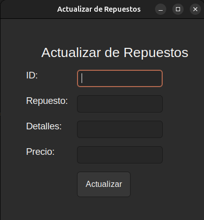

### Visualización de Repuestos
Al momento de visualizar los repuestos, tendrá 3 opciones como quiera verlos, en Pre-Orden, In-Orden y Post-Orden

 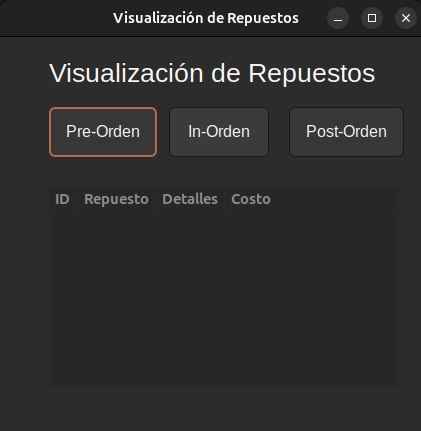

---

### Generacion de Servicios
El administrador Podra generar Servicios 

 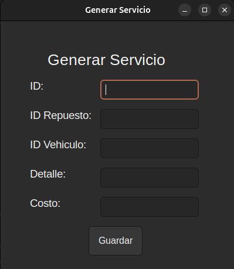

---

### Control de Logueo
El sistema registra la entrada y salida de cada usuario.

#### Pasos:
1. Accede a la opción **"Control de Logueo"** en el menú.
2. Se mostrará un listado con el registro de entradas y salidas de los usuarios.
3. Los datos se pueden exportar en formato JSON para su revisión.

 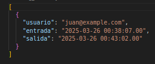

---

### Generación de Reportes
Graphviz genera imágenes que representan las estructuras de datos del sistema.

#### Pasos:
1. Selecciona la opción **"Generar Reportes"**.
2. Elige el tipo de reporte que deseas visualizar (Usuarios, Vehículos, Repuestos, Servicios, Facturación).
3. Se generará y mostrará la imagen correspondiente.
4. Los reportes se almacenan en la carpeta `/Reportes` del sistema.

 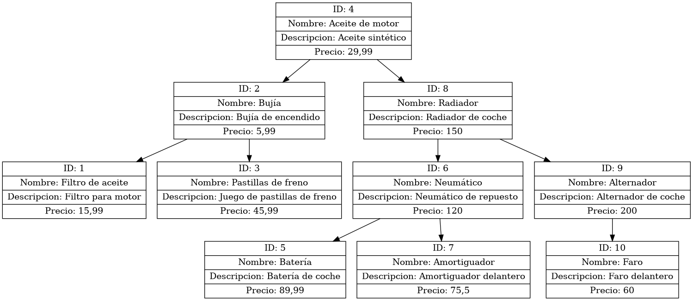

---

## 4. Funcionalidades para el Usuario

### Registro de Vehículos
Los usuarios pueden agregar sus propios vehículos al sistema.

#### Pasos:
1. Selecciona **"Insertar Vehículos"** en el menú.
2. Completa el formulario con la información solicitada (ID, Marca, Modelo y Placa).
3. Presiona **"Registrar"** para agregar el vehículo.

 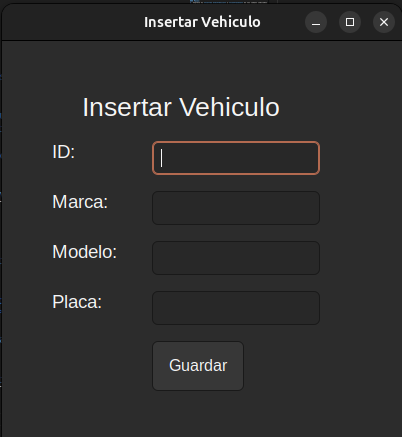

---

### Visualización de Servicios
Los usuarios pueden consultar los servicios realizados a sus vehículos.

#### Pasos:
1. Accede a la opción **"Visualización de Servicios"**.
2. Selecciona el método de filtrado: **Pre-Orden**, **In-Orden** o **Post-Orden**.
3. Se mostrará una lista de servicios asociados a tus vehículos.

 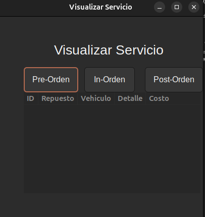

---

### Visualización y Cancelación de Facturas
Los usuarios pueden ver sus facturas pendientes y proceder al pago (cancelación).

#### Pasos:
1. Selecciona **"Visualización de Facturas o Cancelar Factura"**.
2. Revisa la lista de facturas pendientes.
3. Para cancelar una factura, ingresa el **ID** de la factura en el campo correspondiente y haz clic en **"Pagar"** en la opción de cancelar Factura.
4. Una vez pagada, la factura será eliminada del sistema.

#### Visualizar Factura:

 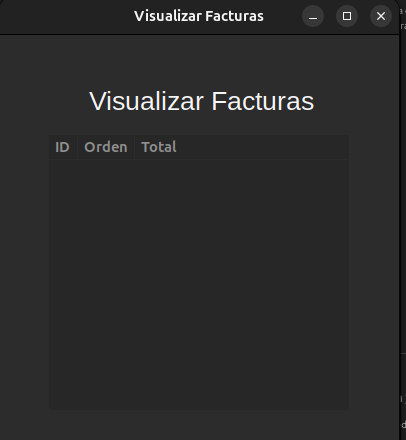

#### Cancelar Factura:

 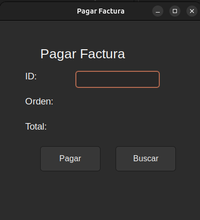

