UNIVERSIDAD DE SAN CARLOS DE GUATEMALA

FACULTAD DE INGENIERIA

ESTRUCTURA DE DATOS

CATEDRÁTICO: ING. ESPINO

============================================================================================

  
  

    <h1 style="color: blue; text-decoration: underline; text-decoration-color: black;" >MANUAL DE USUARIO AUTOGEST PRO</h1>
  

============================================================================================

OTTONIEL FABRICIO VÁSQUEZ PINEDA
 
CARNÉ: 202307820
 
SECCIÓN C

GUATEMALA 25 DE MARZO DEL 2025

# Manual de Usuario – AutoGest Pro

Bienvenido a **AutoGest Pro**, el sistema integral para la gestión de talleres de reparación de vehículos. Este manual te guiará a través de las funcionalidades disponibles, tanto para usuarios como para el administrador. A continuación se presentan las instrucciones paso a paso para que puedas aprovechar al máximo el sistema.

---

<h2 align="center"> Introducción </h2>
AutoGest Pro es un sistema integral para la gestión de talleres de reparación de vehículos. Con esta herramienta podrás:

Registrar vehículos y clientes.
Gestionar repuestos, servicios y facturación.
Visualizar reportes e informes relevantes sobre el taller.
Subir archivo .JSON para registrar más rapido a los usuarios, vehículos y repuestos.
Este manual te ayudará a navegar por la aplicación, explicándote paso a paso cómo realizar cada acción.

---

---
  
## 1. Inicio de Sesión

Al abrir **AutoGest Pro**, se presenta la pantalla de inicio de sesión.

### Pasos:
1. Ingresa tu **correo electrónico** y **contraseña** en los campos indicados.
2. Presiona el botón **"Iniciar Sesión"**.

> **Nota:**  
> El usuario administrador cuenta con las credenciales:  
> **Correo:** `admin@usac.com`  
> **Contraseña:** `admin23`

 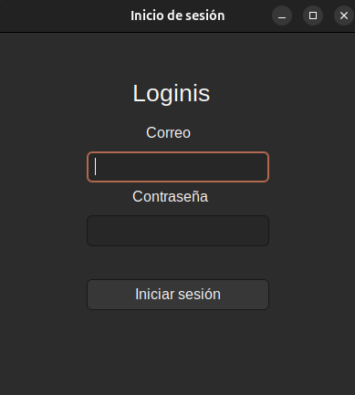

---

## 2. Menú Principal

Una vez autenticado, se mostrará el menú principal que varía según el rol del usuario (Administrador o Usuario).

### Elementos del menú Administrador:
- **Carga Masiva** (solo para Administrador)
- **Gestión de Entidades** (Usuarios, Repuestos)
- **Visualización de Repuestos**
- **Generación de Servicios y Facturas**
- **Control de Logueo**
- **Reportes**
- **Generar Backup**
- **Cerrar sesión**

### Elementos del menú Usuario:
- **Visualizar Vehículos**
- **Visualizacion de Servicios**
- **Visualizacion de Facturas**
- **Cerrar sesión**

### Menu Administrador

 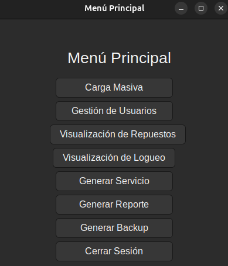

### Menu Usuario

 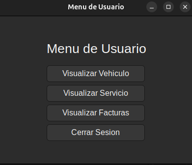

---

## 3. Funcionalidades para el Administrador

### Carga Masiva
El administrador puede cargar datos de **Usuarios**, **Vehículos** y **Repuestos** de forma masiva mediante archivos JSON.

#### Pasos:
1. Selecciona la opción **"Carga Masiva"** en el menú.
2. Elige la entidad que deseas cargar.
3. Haz clic en **"Seleccionar Archivo"** y busca el archivo JSON correspondiente.
4. Presiona **"Cargar"** para importar los datos.

 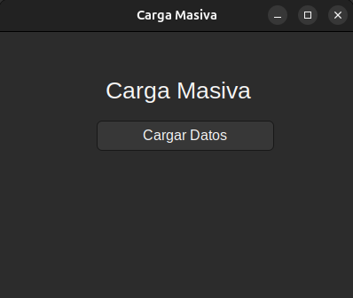

---

### Gestión de Usuarios
El administrador tiene la opción de **Visualizar** y **Agregar** registros de:
- **Usuarios**

#### Pasos:
1. Selecciona la opción **"Gestión de Usuarios"**.
2. Elige la entidad a gestionar.
3. Se mostrara si quiere ver que usuario quiere ver por medio del ID.
4. Podras agregar usuario

### Gestión Usuarios

 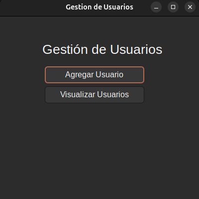

### Agregar Usuario

 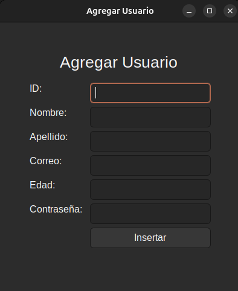

### Visualizar Usuario

 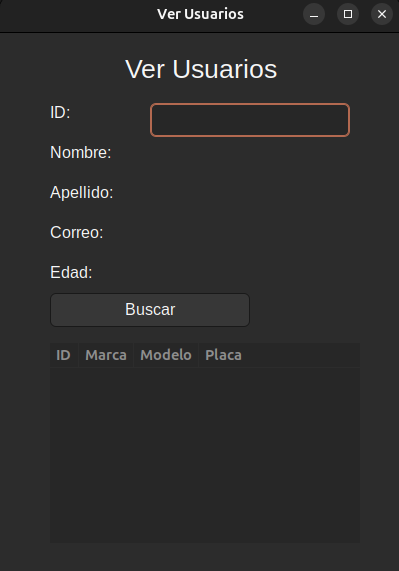

---

### Visualización de Repuestos
El administrador, podrá ver todo los repuestos en diferente orden.

 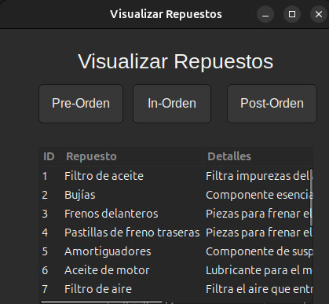

### Visualización de Logueo
El administrador podrá ver a todos los usuarios que se han logueado y la hora y el día que se loguearon.

 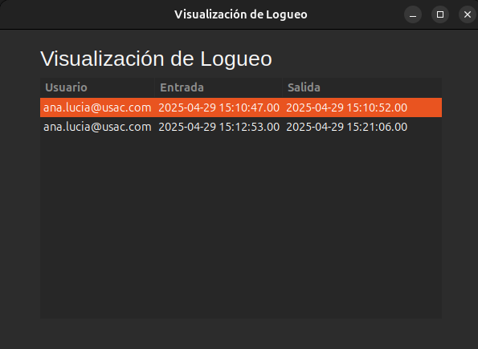

### Generar Servicio
El administrador podrá hacer servicios de los usuarios.

 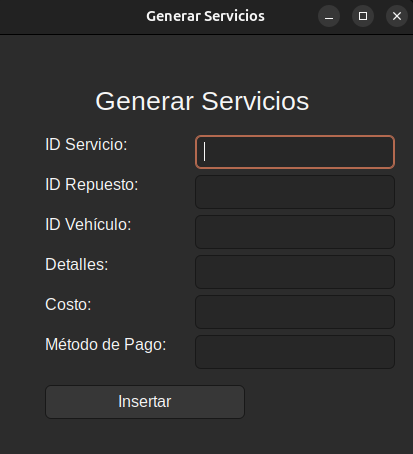

### Generar Reporte
El administrador podrá generar todos los reportes en graphviz.

 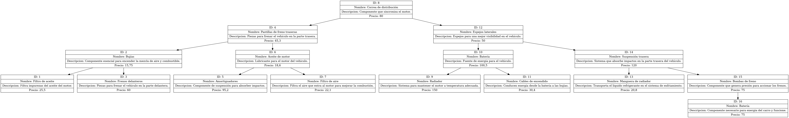

### Generar Backup
El administrador podrá generar backup como un respaldo de los datos ingresados.

 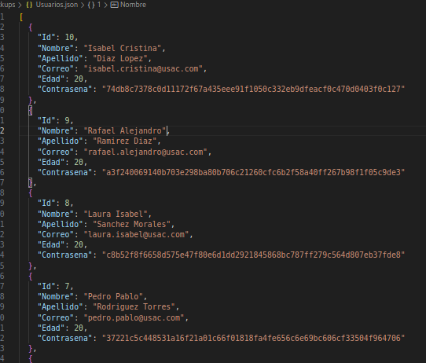

---

## 4. Funcionalidades para el Usuario

### Visualizar Vehiculo
Los usuarios podrán visualizar las Vehiculos que tienen

 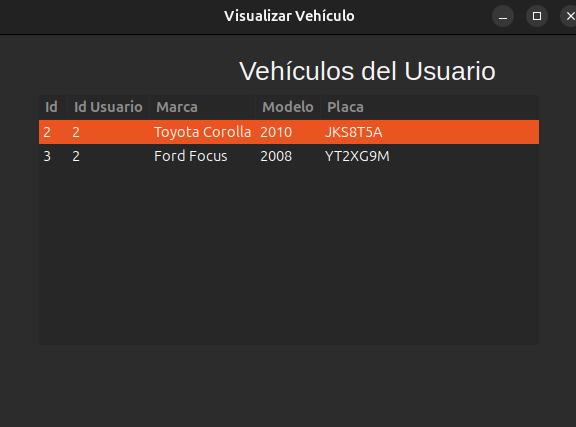

### Visualizar Servicio
Los usuarios podrán visualizar las Servicios que tienen

 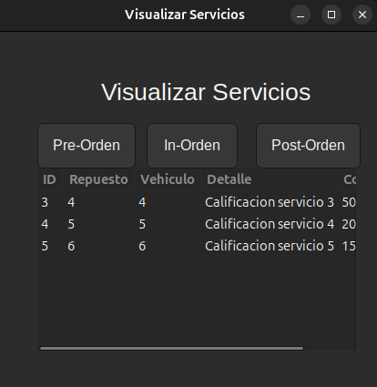

### Visualizar Factura
Los usuarios podrán visualizar las Facturas que tienen

 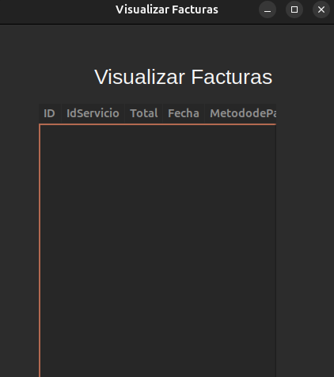

